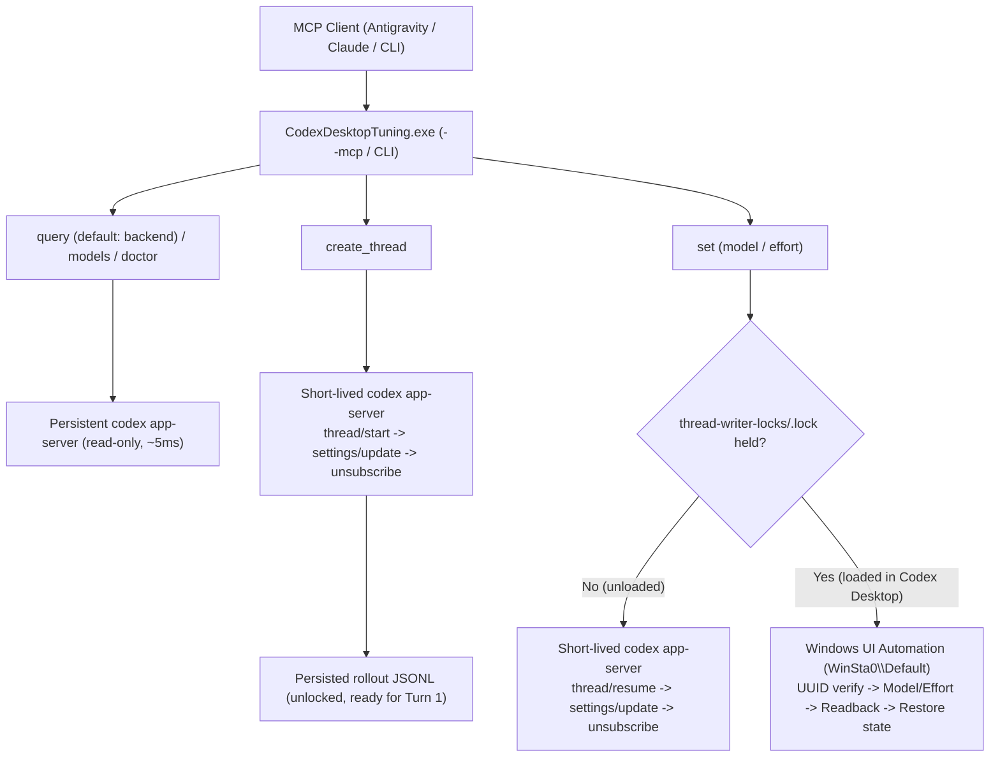

# Codex Desktop Tuning MCP

**English** | [简体中文](./README.zh-CN.md)

[](https://github.com/40010-prototype/codex-tuner-mcp)
[-512BD4)](https://github.com/40010-prototype/codex-tuner-mcp)
[](https://modelcontextprotocol.io/)
[](./LICENSE)

A lightweight (~100 KB), zero-dependency, offline-deterministic **MCP server & CLI** for controlling **OpenAI Codex Desktop** models, reasoning effort levels, and pre-tuned new conversations on Windows — with **zero inference tokens**, **no process injection**, **no internal DB writes**, and **no generic shell execution**.

Designed especially for **multi-agent collaboration workflows** (e.g., Antigravity / Claude Code orchestrating Codex Desktop via Agent HUD) where an orchestrator needs to dynamically tune Codex's model and thinking depth before each turn.

---

## Highlights

- **Dual-Path Automatic Routing**:
  - **Unlocked threads** → Official `codex.exe app-server --stdio` (`thread/settings/update`), 100% background, zero UI clicks, <0.3s.
  - **Desktop-loaded threads** (writer-lock held by `ChatGPT.exe`) → Safe native **Windows UI Automation (UIA)** with deep-link UUID verification, post-write readback, and automatic restoration of focus, sidebar chat, and minimized state (~3.5s combined model + effort).
- **Pre-Tuned New Threads (`create_thread`)**: Creates a persistent, unlocked Codex thread with your exact chosen `model`, `effort`, `cwd`, and optional `title` (0 inference tokens) — so even **Turn 1** runs on the exact model and reasoning effort you requested.
- **Persistent Focus Preference (`set_preference`)**: Switch anytime between `restore` (return to your previous window & minimized state), `stay` (leave focus on Codex if tuning brought it forward), or `focus_codex` (always bring Codex forward) — takes effect immediately without restarting MCP or editing Skills.
- **Zero Hardcoded Model / Effort Lists**: Dynamically discovers models and per-model `supportedReasoningEfforts` via official `model/list` (24h TTL cache + instant refresh on miss) and reads `~/.codex/config.toml` live (<1ms), cleanly adapting whether a model has 4, 5, or 6 effort steps (with or without `max` / `ultra`).
- **Built-In Safety & Resilience**:
  - Single-binary .NET Framework 4.8 C# executable compiled locally with Windows' built-in `csc.exe` (no PowerShell `Add-Type` temp compilation).
  - Strictly scoped MCP surface: **7 dedicated tools only**, zero arbitrary command execution.
  - Composite version fingerprinting + automatic UI compatibility circuit breaker (trips after 2 consecutive structural UI errors).
  - Cross-process concurrency mutex, user input idle backoff (`GetLastInputInfo`), unsent-draft guard, and pure Win32 clipboard preservation.

---

## Architecture



---

## Quick Start

### 1. Build Locally (Zero External Dependencies)

Requires Windows 10/11 (x64) with built-in .NET Framework 4.8 (`C:\Windows\Microsoft.NET\Framework64\v4.0.30319\csc.exe`) and OpenAI Codex Desktop installed.

```powershell
git clone https://github.com/40010-prototype/codex-tuner-mcp.git
cd codex-tuner-mcp
powershell.exe -NoProfile -ExecutionPolicy Bypass -File .\build.ps1
```

Or download the pre-built `CodexDesktopTuning.exe` from [GitHub Releases](https://github.com/40010-prototype/codex-tuner-mcp/releases).

### 2. Register as an MCP Server

Add to your MCP config (for **Antigravity**: `~/.gemini/config/mcp_config.json`):

```json
{
  "mcpServers": {
    "codex-tuning": {
      "command": "C:\\path\\to\\codex-tuner-mcp\\CodexDesktopTuning.exe",
      "args": ["--mcp"]
    }
  }
}
```

> **Why native stdio MCP?** In sandboxed coding agents (such as Antigravity), terminal shell commands may execute on an isolated Windows desktop (`WinSta0\exebox-*`) that cannot see interactive desktop windows. Running `CodexDesktopTuning.exe --mcp` as a native stdio MCP server places it directly on `WinSta0\Default` with zero terminal sandbox relaxation.

### 3. Verify Environment

Reload your MCP servers and ask your agent to call `capabilities` or `doctor`:

```json
// Expected key fields from capabilities:
{
  "ok": true,
  "serverVersion": "2.5.2",
  "persistentAppServer": true,
  "desktop": {
    "DesktopName": "Default",
    "IsInteractiveDefaultDesktop": true,
    "VisibleWindowCount": 1
  }
}
```

---

## MCP Tools Reference

`CodexDesktopTuning.exe --mcp` exposes strictly **7 tools**:

| Tool | Required Args | Optional Args (with defaults) | Purpose |
|---|---|---|---|
| **`create_thread`** | `cwd` | `model`, `effort`, `title` | Create a new persistent, unlocked Codex thread pre-configured with exact `model` & `effort` (0 tokens). Immediately ready for Turn 1. |
| **`set`** | `threadId` | `model`, `effort`, `title` (auto), `allowForegroundFallback` (`true`), `allowSessionSwitch` (`false`), `allowUnminimize` (`true`), `focusMode` (persisted pref), `ignoreUserIdle` (`false`), `userIdleMs` (`2000`), `lockTimeoutMs` (`0`) | Change model and/or reasoning effort without submitting prompts or triggering inference. |
| **`query`** | `threadId` | `source` (`"backend"` \| `"auto"` \| `"ui"`, default `"backend"`), `title` | Read current `model`, `effort`, and writer-lock status. Default `"backend"` makes zero UI clicks. |
| **`models`** | *(none)* | `refresh` (`false`), `ttlHours` (`24`) | List all available Codex models and their per-model `supportedReasoningEfforts`. |
| **`set_preference`** | `focusMode` | *(none)* | Persist default `focusMode` (`"restore"` \| `"stay"` \| `"focus_codex"`) to `%LOCALAPPDATA%\CodexDesktopTuning\preferences.json`. |
| **`doctor`** | *(none)* | `threadId`, `resetBreaker` (`false`) | Read-only diagnostics (versions, desktop status, caches, mutex, circuit breaker, optional thread probe). |
| **`capabilities`** | *(none)* | *(none)* | Report runtime desktop access, available paths, defaults, and safety invariants. |

### Typical Multi-Agent Workflow Example

1. **Start a brand-new task with Turn 1 on a specific model & effort**:
   ```json
   // Step 1: codex-tuning:create_thread (0 tokens, <1s)
   {
     "cwd": "C:\\path\\to\\your\\project",
     "model": "gpt-6.1-sol",
     "effort": "low",
     "title": "Architecture Review"
   }
   // -> returns { "ok": true, "threadId": "<new-uuid>", "model": "gpt-6.1-sol", "effort": "low", "writerLockHeld": false }

   // Step 2: Send Turn 1 via Agent HUD (or open in Codex Desktop)
   ```
2. **Dynamically upgrade/downgrade an existing conversation before the next turn**:
   ```json
   // codex-tuning:set
   {
     "threadId": "<thread-uuid>",
     "model": "gpt-6.2-sol",
     "effort": "high"
   }
   ```
3. **Check current settings silently (zero UI clicks)**:
   ```json
   // codex-tuning:query
   {
     "threadId": "<thread-uuid>"
   }
   ```
4. **Switch focus preference anytime without changing prompts**:
   ```json
   // codex-tuning:set_preference
   {
     "focusMode": "restore"      // "restore" | "stay" | "focus_codex"
   }
   ```

---

## Focus Control Modes (`focusMode`)

Saved in `%LOCALAPPDATA%\CodexDesktopTuning\preferences.json` (read live on every call):

| Mode | Behavior After Tuning |
|---|---|
| **`restore`** *(default)* | If Codex was **not** foreground before tuning and **still** holds focus afterward, switches focus back to your previous window; if Codex started minimized, re-minimizes it (`SW_SHOWMINNOACTIVE`). If you manually clicked another app mid-run (or started in Codex), does nothing. |
| **`stay`** | Never pulls focus away from Codex if tuning brought it forward; if tuning stayed purely in background, leaves your current window untouched. |
| **`focus_codex`** | Actively restores & focuses Codex Desktop after tuning (even on pure-background `app-server` paths), ready for you to watch Codex think. |

---

## CLI Usage

Every MCP tool is also available directly via CLI (outputs structured UTF-8 JSON; add `--pretty` for formatted output):

```powershell
.\CodexDesktopTuning.exe doctor --thread-id <uuid> --pretty
.\CodexDesktopTuning.exe models --refresh --pretty
.\CodexDesktopTuning.exe query --thread-id <uuid> --pretty
.\CodexDesktopTuning.exe create-thread --cwd "C:\path\to\project" --model gpt-6.1-sol --effort low --title "New Task"
.\CodexDesktopTuning.exe set --thread-id <uuid> --model gpt-6.2-sol --effort medium
.\CodexDesktopTuning.exe set --thread-id <uuid> --model gpt-6.1-sol --effort low --allow-session-switch
.\CodexDesktopTuning.exe set-preference --focus-mode restore
.\CodexDesktopTuning.exe doctor --reset-breaker
```

---

## Security & Safety Invariants

- **Offline & Zero Telemetry**: Communicates exclusively with your local `codex.exe` and local `ChatGPT.exe` window.
- **No Arbitrary Execution**: No shell/command execution tools; strict JSON schema validation (`additionalProperties: false`).
- **No Process Injection / No DB Hacks**: Uses only documented `codex app-server` JSON-RPC and standard Windows UI Automation.
- **Verified Identity**: Before mutating any Desktop-loaded thread via UIA, verifies the unique window, chat toolbar title, empty composer, idle status, and `codex://threads/<uuid>` deep link via sequence-guarded Win32 clipboard read/restore.
- **Compatibility Circuit Breaker**: Caches UI compatibility keyed by `InstalledPackageVersion | RunningFileVersion | OwlAppVersion | CodexCliVersion | UiLocale`. Version upgrades auto-invalidate; 2 consecutive structural UI errors open the breaker (exit code `2`) to prevent blind retries.

---

## Known Limitations

1. **Writer Lock Exclusivity on Codex Desktop**: When Codex Desktop holds `~/.codex/thread-writer-locks/<uuid>.lock`, external `codex app-server` `thread/resume` returns `already has an active writer`. Furthermore, recent Windows Codex Desktop builds (e.g., `26.1117.3838.0`) do not expose the internal `\\.\pipe\codex-ipc` follower pipe (upstream `#62712`). Until an official attach/follower RPC is available, Desktop-loaded threads use the UIA path.
2. **Effort Slider Focus Requirement**: Codex Desktop currently exposes its reasoning-effort control as a keyboard-driven `MenuItem` rather than a native `RangeValuePattern` / `RadioButton` (both of which this tool probes first). Changing effort on a Desktop-loaded thread briefly activates Codex (~0.8s) and then applies `focusMode` (`restore` returns focus immediately).
3. **UI Localization**: UIA control names currently target the `zh-CN` Codex Desktop UI (with automatic `<k> of <n>` scale fallback for effort labels). Official `app-server` paths (`query`, `models`, `create_thread`, and unlocked `set`) are completely locale-independent.

---

## Project Structure

```text
├── src/
│   ├── Models.cs                # Data contracts & exception types
│   ├── VersionDetector.cs       # Appx/EXE/Owl/CLI version fingerprint & config.toml reader
│   ├── CacheStore.cs            # Atomic JSON caches (compat, models TTL, preferences)
│   ├── AppServerClient.cs       # Official codex app-server --stdio JSON-RPC 2.0 client
│   ├── DesktopUiaController.cs  # Safe Windows UIA controller, Win32 clipboard, focus/unminimize
│   ├── McpServer.cs             # Minimal STA stdio MCP server (7 dedicated tools)
│   └── Program.cs               # Unified CLI/MCP router, persistent read pool, cross-process mutex
├── build.ps1                    # Zero-dependency local compiler using Windows csc.exe
├── Codex-DesktopTuning.ps1      # Optional PowerShell CLI wrapper
├── .github/workflows/release.yml
├── README.md
├── README.zh-CN.md
└── LICENSE
```

---

## License

[MIT](./LICENSE)
