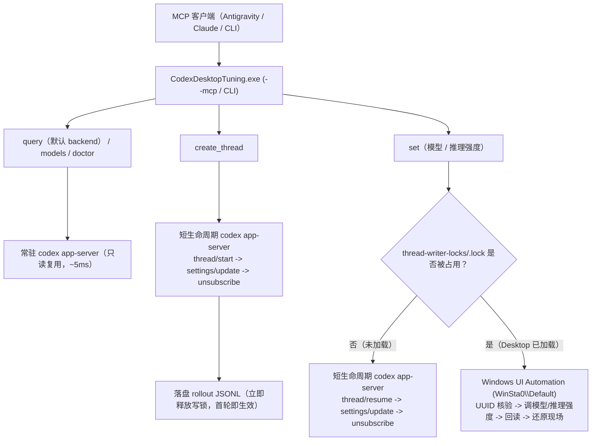

# Codex Desktop Tuning MCP

[English](./README.md) | **简体中文**

[](https://github.com/40010-prototype/codex-tuner-mcp)
[-512BD4)](https://github.com/40010-prototype/codex-tuner-mcp)
[](https://modelcontextprotocol.io/)
[](./LICENSE)

轻量（~100 KB）、零外部依赖、离线确定性的 Windows **Codex Desktop 模型与推理强度控制 MCP 服务器 / CLI** —— **零推理 Token 消耗、无进程注入、不篡改内部数据库、无通用命令执行能力**。

专为 **多 Agent 协作工作流**（例如 Antigravity / Claude Code 通过 Agent HUD 编排调度 Codex Desktop）设计，支持在每轮派发任务前动态调整 Codex 会话的模型与思考深度，也支持按指定档位零消耗新建会话。

---

## 核心亮点

- **双路径自动路由**：
  - **未加载会话**（无写锁占用）→ 走官方 `codex.exe app-server --stdio`（`thread/settings/update`），100% 纯后台、零点击、<0.3 秒完成。
  - **Codex Desktop 已加载会话**（`ChatGPT.exe` 持有 writer lock）→ 走原生 **Windows UI Automation (UIA)**，附带深链 UUID 核验、写后回读，并在结束后自动还原**窗口焦点、原对话页与最小化状态**（联合切换模型+推理强度约 3.5 秒）。
- **预设档位新建对话（`create_thread`）**：纯后台、0 Token 创建一个已持久化指定 `model`、`effort`、`cwd` 和可选 `title` 的未持锁新会话，确保连**第 1 轮消息**也精准运行在目标档位上。
- **持久化焦点偏好（`set_preference`）**：随时在 `restore`（切回原窗口与最小化状态）、`stay`（不切回）、`focus_codex`（主动切去 Codex 盯进度）之间切换，立即落盘生效，无需重启 MCP 或改动 Skill 提示词。
- **无硬编码模型与滑块档位**：通过官方 `model/list` 动态发现模型目录与单模型支持的推理档位（24 小时 TTL 缓存，未命中自动刷新），每次调用实时读取 `~/.codex/config.toml`（<1ms），配合界面 `<k> of <n>` 双锚点对齐，无论 4/5/6 档或是否开启 `max` / `ultra` 均自动适配。
- **工程级安全与稳定保障**：
  - 使用 Windows 自带 `.NET Framework 4.8 csc.exe` 编译的单文件原生程序（告别 PowerShell `Add-Type` 临时目录动态编译导致的杀软误报）。
  - 最小权限面：仅暴露 **7 个专用 MCP 工具**，绝不提供任意 Shell 执行。
  - 组合版本指纹缓存 + 结构性兼容熔断器（连续 2 次结构性 UI 错误自动熔断防误操作）。
  - 跨进程并发互斥锁、用户输入活跃避让（`GetLastInputInfo`）、未发送草稿保护、纯 Win32 剪贴板序号保护与还原。

---

## 工作原理



---

## 快速开始

### 1. 本地零依赖编译

环境要求：Windows 10/11 (x64)（系统自带 `C:\Windows\Microsoft.NET\Framework64\v4.0.30319\csc.exe`）+ 已安装 OpenAI Codex Desktop。

```powershell
git clone https://github.com/40010-prototype/codex-tuner-mcp.git
cd codex-tuner-mcp
powershell.exe -NoProfile -ExecutionPolicy Bypass -File .\build.ps1
```

也可以直接从 [GitHub Releases](https://github.com/40010-prototype/codex-tuner-mcp/releases) 下载预编译好的 `CodexDesktopTuning.exe`。

### 2. 配置为 MCP 服务器

合并进你的 MCP 配置文件（**Antigravity** 为 `~/.gemini/config/mcp_config.json`）：

```json
{
  "mcpServers": {
    "codex-tuning": {
      "command": "C:\\path\\to\\codex-tuner-mcp\\CodexDesktopTuning.exe",
      "args": ["--mcp"]
    }
  }
}
```

> **为什么推荐走原生 stdio MCP？** 在带沙盒保护的编码 Agent（如 Antigravity）中，终端命令常运行在隔离桌面 `WinSta0\exebox-*`，无法枚举主桌面窗口；而原生 stdio MCP 由宿主直接在 `WinSta0\Default` 拉起，既能正常访问 Codex Desktop，又不需要放宽终端沙盒权限。

### 3. 刷新并自检

刷新 MCP 后让 Agent 调用 `capabilities` 或 `doctor`：

```json
{
  "ok": true,
  "serverVersion": "2.5.2",
  "persistentAppServer": true,
  "desktop": {
    "DesktopName": "Default",
    "IsInteractiveDefaultDesktop": true,
    "VisibleWindowCount": 1
  }
}
```

---

## MCP 工具完整参考

`CodexDesktopTuning.exe --mcp` 仅暴露以下 **7 个专用工具**：

| 工具名 | 必填参数 | 可选参数（含默认值） | 用途 |
|---|---|---|---|
| **`create_thread`** | `cwd` | `model`、`effort`、`title` | 0 Token 创建预先设定好模型和推理强度的未持锁新会话，首轮发消息即按指定档位执行 |
| **`set`** | `threadId` | `model`、`effort`、`title`（自动补全）、`allowForegroundFallback`（`true`）、`allowSessionSwitch`（`false`）、`allowUnminimize`（`true`）、`focusMode`（读取持久化偏好）、`ignoreUserIdle`（`false`）、`userIdleMs`（`2000`）、`lockTimeoutMs`（`0`） | 无推理消耗切换已有会话的模型与推理强度 |
| **`query`** | `threadId` | `source`（`"backend"` \| `"auto"` \| `"ui"`，默认 `"backend"`）、`title` | 查询当前模型、推理强度与锁状态；默认 `"backend"` 全程后台零 UI 点击 |
| **`models`** | 无 | `refresh`（`false`）、`ttlHours`（`24`） | 动态列出当前账号可用模型及每个模型支持的思考深度 |
| **`set_preference`** | `focusMode` | 无 | 持久化保存焦点偏好（`"restore"` \| `"stay"` \| `"focus_codex"`），立即生效 |
| **`doctor`** | 无 | `threadId`、`resetBreaker`（`false`） | 只读诊断（版本指纹、桌面环境、缓存、互斥锁、熔断器及可选会话探测） |
| **`capabilities`** | 无 | 无 | 上报运行环境、可用路径、当前偏好默认值与安全不变量 |

### 典型多 Agent 协作调用流

1. **按指定模型和推理强度新开任务（首轮即生效）**：
   ```json
   // 第 1 步：codex-tuning:create_thread（0 Token，纯后台）
   {
     "cwd": "C:\\path\\to\\your\\project",
     "model": "gpt-6.1-sol",
     "effort": "low",
     "title": "架构方案调研"
   }
   // -> 返回 { "ok": true, "threadId": "<new-uuid>", "model": "gpt-6.1-sol", "effort": "low", "writerLockHeld": false }

   // 第 2 步：用 Agent HUD send_message 向该 threadId 发送第 1 条消息
   ```
2. **已有会话按任务难度动态升降档**：
   ```json
   // codex-tuning:set
   {
     "threadId": "<thread-uuid>",
     "model": "gpt-6.2-sol",
     "effort": "high"
   }
   ```
3. **静默查询当前档位（零弹窗、零点击）**：
   ```json
   // codex-tuning:query
   {
     "threadId": "<thread-uuid>"
   }
   ```
4. **随时切换焦点习惯（无需改 Skill / 重启 MCP）**：
   ```json
   // codex-tuning:set_preference
   {
     "focusMode": "restore"      // "restore" | "stay" | "focus_codex"
   }
   ```

---

## 焦点控制模式（`focusMode`）

偏好文件持久化于 `%LOCALAPPDATA%\CodexDesktopTuning\preferences.json`（每次调用实时读取）：

| 模式 | 调档结束后的行为 |
|---|---|
| **`restore`**（默认） | 若操作前焦点不在 Codex 且结束时焦点仍在 Codex，自动切回原窗口；若原本最小化，自动通过 `SW_SHOWMINNOACTIVE` 重新缩回最小化。如果中途你手动切去了其他应用，或操作前本来就在 Codex，则什么都不做。 |
| **`stay`** | 被动不切回：若调档过程把焦点带到了 Codex 就直接停在 Codex；若全程后台未动焦点，也不额外弹窗。 |
| **`focus_codex`** | 改完后主动把 Codex Desktop 还原并切到前台（即使本次走的是纯后台 `app-server` 路径），适合每次派活后直接盯 Codex 思考。 |

---

## 命令行（CLI）调用

所有能力均支持命令行直接调用，输出结构化 UTF-8 JSON（加 `--pretty` 可格式化输出）：

```powershell
.\CodexDesktopTuning.exe doctor --thread-id <uuid> --pretty
.\CodexDesktopTuning.exe models --refresh --pretty
.\CodexDesktopTuning.exe query --thread-id <uuid> --pretty
.\CodexDesktopTuning.exe create-thread --cwd "C:\path\to\project" --model gpt-6.1-sol --effort low --title "新调研主题"
.\CodexDesktopTuning.exe set --thread-id <uuid> --model gpt-6.2-sol --effort medium
.\CodexDesktopTuning.exe set --thread-id <uuid> --model gpt-6.1-sol --effort low --allow-session-switch
.\CodexDesktopTuning.exe set-preference --focus-mode restore
.\CodexDesktopTuning.exe doctor --reset-breaker
```

---

## 安全与边界说明

- **完全离线、零遥测**：仅与本机 `codex.exe` 和本机 `ChatGPT.exe` 窗口通信。
- **最小权限面**：无任意 Shell / 命令执行工具，所有工具参数严格校验（`additionalProperties: false`）。
- **无侵入**：不注入目标进程，不修改 Codex 内部 SQLite 数据库。
- **写前强校验**：UIA 写入前依次核验唯一窗口、工具栏标题、空输入框、空闲态，并通过纯 Win32 剪贴板序号保护复制核验 `codex://threads/<uuid>` 深度链接，完成后还原原剪贴板内容。
- **版本感知与熔断**：按 `InstalledPackageVersion | RunningFileVersion | OwlAppVersion | CodexCliVersion | UiLocale` 组合指纹管理兼容缓存；客户端升级自动失效重探；连续 2 次结构性 UI 兼容错误自动熔断（退出码 `2`）。

---

## 已知限制

1. **Codex Desktop 写锁独占**：会话被 Codex Desktop 打开时会长时间持有 `thread-writer-locks/<uuid>.lock`，外部官方 `app-server` 无法直接写入（`already has an active writer`）；且近期 Windows 版（如 `26.1117.3838.0`）不再暴露内部 `\\.\pipe\codex-ipc` 管道（上游 `#62712`）。因此已加载会话当前走 UIA 路径，未加载会话则直接走官方 `app-server` 纯后台写入。
2. **思考深度滑块焦点要求**：当前界面中思考深度项仅暴露为接收方向键的 `MenuItem`（工具会先自动探测原生 `RangeValuePattern` / `RadioButton`），因此已加载会话调整思考深度时会短暂激活 Codex 约 0.8 秒，结束后再按 `focusMode` 自动切回。
3. **界面语言**：UIA 控件名目前适配简体中文（`zh-CN`）Codex Desktop（思考档位标签已支持通过 `<k> of <n>` 刻度自动兜底）；走官方 `app-server` 的路径（`query`、`models`、`create_thread` 与未持锁 `set`）完全不依赖界面语言。

---

## 目录结构

```text
├── src/
│   ├── Models.cs                # 数据模型与异常定义
│   ├── VersionDetector.cs       # Appx/EXE/Owl/CLI 版本指纹与 config.toml 读取
│   ├── CacheStore.cs            # 原子 JSON 缓存（兼容策略、24h 模型目录、用户偏好）
│   ├── AppServerClient.cs       # 官方 codex app-server --stdio JSON-RPC 2.0 客户端
│   ├── DesktopUiaController.cs  # Windows UIA 安全控制、Win32 剪贴板、焦点与最小化恢复
│   ├── McpServer.cs             # 极简 STA stdio MCP 服务器（7 个专用工具）
│   └── Program.cs               # CLI/MCP 统一入口、只读长连接复用、跨进程互斥锁
├── build.ps1                    # 使用 Windows 自带 csc.exe 一键零依赖编译
├── Codex-DesktopTuning.ps1      # 可选 PowerShell CLI 兼容包装脚本
├── .github/workflows/release.yml
├── README.md
├── README.zh-CN.md
└── LICENSE
```

---

## 开源协议

[MIT](./LICENSE)
